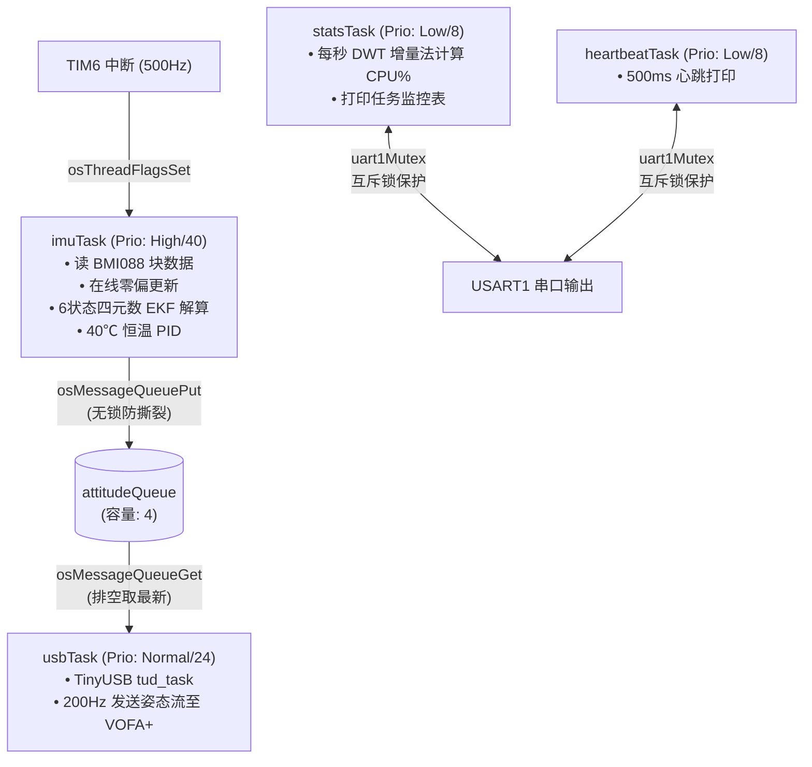

# DM02 机械臂嵌入式核心固件工程

[](https://www.st.com/)
[](https://www.freertos.org/)
[](https://cmake.org/)
[](https://www.bosch-sensortec.com/)

DM02 是基于达妙科技 **DM-MC02** 机械臂主控开发板研发的高实时、高可靠机器人端侧核心固件。项目深度融合了 **FreeRTOS (CMSIS-RTOS v2)** 多任务操作系统，构建了标准清晰的五层高内聚低耦合软件框架，集成了微秒级自包含 6 状态四元数扩展卡尔曼滤波（EKF）姿态解算、40℃ 恒温 PID 控制、TinyUSB CDC 高速遥测流以及 ST7789 LCD 菜单人机交互系统。

---

## 🌟 核心特性

- **高精度自适应 IMU 解算**：
  - 搭载 Bosch BMI088 六轴高性能惯性传感器（SPI 块读优化，耗时仅 57µs）。
  - 开机 1s 静态零偏标定 + x-io Fusion 运行时在线动态零偏微调（有效追踪温度漂移，含 Z 轴 Yaw 零偏补偿）。
  - 自包含 6 状态四元数 EKF 姿态算法（无 CMSIS-DSP 外部库与 malloc 动态内存依赖），带卡方检验自适应抗线加速度干扰。
  - 标准 ZYX 欧拉角（Roll $\pm 180^\circ$、Pitch $\pm 90^\circ$、Yaw $\pm 180^\circ$）及支持连续多圈累加的航向角输出（`YawTotalAngle`）。
  - 闭环恒温 PID 控制（TIM3 PWM 驱动，将传感器稳定在 40°C，大幅抑制温漂）。
  - **极限漂移控制**：在无磁力计严苛硬件条件下，稳态航向漂移控制在约 **0.02 ~ 0.1°/min**。
- **现代化 FreeRTOS 实时调度**：
  - SysTick 专供 FreeRTOS 内核（1kHz 节拍），TIM15 独立承载 HAL 时基。
  - 任务间姿态传递采用 CMSIS 消息队列（`attitudeQueueHandle`），杜绝跨线程全局变量撕裂读。
  - 共享外设（USART1 任务监视器 / 心跳流）配备天生带优先级继承的互斥锁（`osMutex`），彻底解决字符穿插与优先级反转隐患。
  - 任务级 DWT 周期计数增量分析，实时统计并输出精准的系统 CPU% 占用率。
- **五层解耦软件架构（`User_File/`）**：
  - 业务逻辑全面收敛于 `User_File/`，严格遵循 **BSP → Driver → Algorithm → Module → Application** 分层设计，工程结构清晰，扩展性强。
- **丰富的板载外设与人机交互**：
  - 基于 TinyUSB 的 USB-CDC 高速通信，原生适配 VOFA+ JustFloat 姿态流绘制。
  - ST7789 1.14 寸 SPI 彩屏驱动（单次片选分块加速），搭配 PA5 ADC 独立五向键采样解码与状态机菜单。

---

## 🛠️ 硬件规格与引脚映射

| 外设模块 | 核心芯片 / 引脚 | 接口配置 | 作用说明 |
|---|---|---|---|
| **主控 MCU** | STM32H723XG | Cortex-M7 @ 240MHz | 单核 512KB SRAM / 1024KB Flash |
| **外部晶振** | HSE 24MHz | 外部无源晶振 | 提供稳定系统主频及 48MHz USB 专用时钟 |
| **惯导传感器** | BMI088 六轴 | SPI2 (6MHz) | `ACC_CS: PC0` / `GYRO_CS: PC3` / `ACC_INT: PE10` |
| **恒温加热** | N-MOS 加热阻丝 | TIM3 CH4 (PB1) | PWM 恒温 PID 闭环控制 (目标 40℃) |
| **彩色液晶屏** | ST7789 (240x135) | SPI1 (SCK: PB3, MOSI: PD7) | `CS: PE15`, `DC: PD10`, `RST: PB11`, `BL: PB10` |
| **导航按键** | 五向阻值按键 | ADC1 IN19 (PA5) | 16位单次采样，三级去抖软件解码 |
| **高速通信** | USB OTG HS (FS PHY) | PB14 (DM), PB15 (DP) | TinyUSB CDC 虚拟串口 @ 200Hz 姿态流 |
| **调试串口** | CH340 虚拟串口 | USART1 (PA9 TX, PA10 RX) | 115200 8N1，输出实时任务状态表 |

---

## 📐 软件分层架构

工程采用模块化五层解耦设计，所有开发者自写业务代码均收敛在 `User_File/` 目录中：

```text
User_File/
├── BSP/                  # 板级与硬件外设驱动封装
│   ├── DWT/              # 基于 Cortex-M7 CYCCNT 的微秒级高精度计时与延时
│   ├── UART/             # 调试串口 USART1 驱动及线程安全打印
│   └── USB/              # TinyUSB CDC 栈封装与 VOFA+ JustFloat 通信协议
├── Driver/               # 元器件与板载硬件驱动
│   ├── BMI088/           # BMI088 寄存器配置与 DMA/块读优化 SPI 驱动
│   ├── LCD/              # ST7789 彩屏驱动、图形绘制与字库
│   ├── Key/              # PA5 ADC 五向按键初始化、16位采样与滤波去抖
│   └── Motor/            # 电机驱动抽象层 (预留)
├── Algorithm/            # 纯数学与解算算法 (零硬件依赖)
│   ├── Quaternion/       # 自包含 6 状态四元数 EKF 姿态估计核心
│   └── Kalman/           # 扩展卡尔曼滤波算法库 (预留)
├── Module/               # 机器人功能单元组合
│   └── IMU/              # IMU 传感器综合调度、标定、温漂在线校正与恒温 PID
└── Application/          # FreeRTOS 任务调度与上层业务编排
    ├── Menu/             # ST7789 多级交互菜单状态机与渲染任务
    ├── Demo/             # 优先级反转与互斥锁演示模块
    ├── robot_task.c      # 机器人顶层行为规划任务 (占位)
    └── control_task.c    # 底层闭环运动控制任务 (占位)
```

---

## ⏱️ FreeRTOS 实时调度拓扑

系统时基严格拆分：**SysTick 归 FreeRTOS（1kHz）**，**TIM15 归 HAL 时基**。



---

## ⚡ 性能测试基准

在 STM32H723XG @ 240MHz 主频下的实测基准表现：

| 测试项目 | 编译配置 (-O0 Debug) | 编译优化 (-Os Release) | 备注说明 |
|---|---|---|---|
| **BMI088 SPI 块读耗时** | 131 µs | **57 µs** | 一次 TransmitReceive 连续读取 |
| **四元数 EKF 单次解算** | 283 µs | **141 µs** | 纯硬件单精度浮点运算 (FPU) |
| **恒温 PID 运算耗时** | 1 µs | **< 1 µs** | 位置式 PID 控制 |
| **imuTask 整体 CPU 占比** | 21% | **约 10%** | @ 500Hz 刷新率 |
| **系统空闲率 (IDLE)** | 77% | **86% ~ 88%** | 算力余量极其充沛 |
| **Yaw 轴稳态漂移率** | ~0.05°/min | **0.02 ~ 0.1°/min** | 无磁力计条件下极限表现 |

---

## 🚀 快速上手

### 1. 环境准备
- **构建工具**：CMake (>= 3.22) 与 Ninja
- **交叉编译器**：`arm-none-eabi-gcc` (支持 ARMv7E-M, 硬浮点 `fpv5-d16`)
- **烧录工具**：STM32CubeProgrammer CLI 或 xPack OpenOCD 0.12+

### 2. 编译工程
推荐使用 Release 模式编译以发挥 EKF 硬件浮点极致性能：
```bash
# 配置并生成 Ninja 构建树 (Release)
cmake --preset Release

# 执行多核快速编译
cmake --build --preset Release
```
*构建成功产物位于 `build/Release/DM02.elf`。*

### 3. 固件烧录
使用 STM32CubeProgrammer 命令行一键烧录（Connect-Under-Reset 模式，可防程序跑飞）：
```bash
STM32_Programmer_CLI -c port=SWD mode=UR reset=HWrst -d build/Release/DM02.elf -v -rst
```

### 4. 上位机遥测与观测
1. **VOFA+ 姿态波形观测**：
   - 将 Type-C 数据线连接至开发板 USB 接口，连接串口设备 `/dev/ttyACM0`。
   - 协议模式选择 **JustFloat**，波特率任意。
   - **5 个数据通道定义**：
     - `I0`: **Roll**（横滚角，$\pm 180^\circ$）
     - `I1`: **Pitch**（俯仰角，$\pm 90^\circ$）
     - `I2`: **Yaw**（单圈航向角，$\pm 180^\circ$）
     - `I3`: **YawTotalAngle**（连续多圈累计航向角，无跳变）
     - `I4`: **Temp**（BMI088 芯片实时温度，闭环控制在 40℃ 附近）
2. **USART1 实时任务状态监视器**：
   - 打开板载串口（115200 8N1），每秒自动输出实时任务拓扑表（含状态、优先级、剩余栈深及 CPU% 占用）。

---

## 📄 开源与维护说明

- **固件状态**：已在达妙 DM-MC02 实物硬件与 FreeRTOS 实时多任务环境下充分验证通过，IMU 姿态解算稳定无漂移。
- **扩展指引**：可基于 `User_File/Application/` 与 `User_File/Driver/Motor/` 进一步拓展多轴电机总线驱动与机械臂运动学解算。
